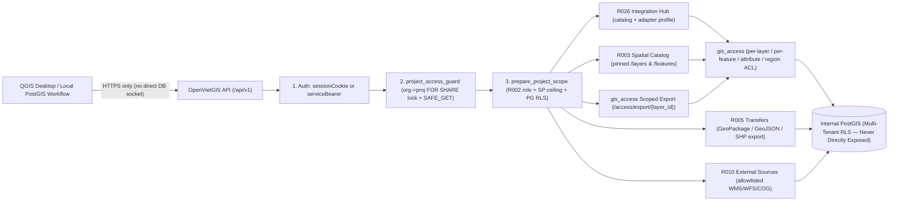

# R026 Architecture — Protocol Boundaries & QGIS / PostGIS Read-Only Adapter (Slice 2 Foundation)

**Specification:** `specs/026-integration-hub-policy`  
**Contract:** `specs/026-integration-hub-policy/contracts/integration-hub-api.yaml`  
**Status:** Architecture & contract baseline (read-only exchange profile foundation; no connector write execution or credential storage)  
**Parent Specifications:** R002 (Identity, Tenancy & Authorization), R003 (Spatial Catalog & Explicit CRS), R005 (Import / Export & Durable Jobs), R006 (Editing & Change History), R010 (External Sources), R012 (CAD Precision), R025 (MicroStation V8i Windows Bridge)

---

## 1. Purpose & Non-Negotiable Invariants

R026 establishes a single, project-scoped **Integration Hub & Policy Gate** that truthfully reports adapter availability, authorization preconditions, and read-only exchange profiles without over-claiming native desktop SDK integration or exposing internal database credentials.

Every Slice 1 and Slice 2 design decision preserves six invariants:

1. **Default Write Policy = `deny`**: Policy evaluations in R026 are descriptive preflights only, never execution tokens or write grants. Having a `project.edit` or `project.manage` role alone never unlocks connector writes.
2. **Never Expose Internal Database Credentials**: OpenVietGIS's internal PostgreSQL / PostGIS instance is a multi-tenant, RLS-enforced storage plane and is never exposed directly to QGIS, `psql`, `ogr2ogr`, or external BI/GIS clients.
3. **Explicit CRS Only — Never Inferred**: Coordinate Reference Systems are governed exclusively by the R003 finite CRS registry (`r003-v1`). Missing, unverified, or definition-only CRS layers fail closed for coordinate exchange.
4. **Defense-in-Depth Authorization**: Project roles (R002), service principal permission ceilings, PostgreSQL RLS, lock-ordered `project_access_guard`, and per-layer / per-feature `gis_access` rules all compose monotonically (strictest restriction wins).
5. **No Proprietary Vendor Binaries or Cloud DCOM**: OpenVietGIS cloud services never link proprietary desktop CAD/GIS SDKs or execute Windows COM/DCOM.
6. **Zero Duplication of Existing Domain Boundaries**: R026 points to verified R003, R005, R006, R010, and `gis_access` APIs rather than re-implementing transport, SSRF, CRS, or mutation logic.

---

## 2. Exact Protocol & Specification Boundaries

| Domain / Spec | Authoritative API Surface (`/api/v1`) | Responsibility & Enforcement Owned Here | Explicit Boundary with R026 |
| :--- | :--- | :--- | :--- |
| **R026 — Integration Hub & Policy Gate** | `GET /organizations/{org}/projects/{proj}/integration-hub/catalog` `GET /organizations/{org}/projects/{proj}/integration-hub/adapters/{adapter_key}` | Versioned adapter inventory, fail-closed `ActionEvaluation` preflight, non-secret `ReadOnlyConnectionProfile`, and ACL-filtered `AdapterLayerDescriptor` listing. | Strictly read-only (`default_write_policy: "deny"`). Stores no connector secrets, performs no outbound HTTP/DB requests, and executes no data writes. |
| **R010 — External Sources** | `/organizations/{org}/external-sources/allowlist` `/organizations/{org}/projects/{proj}/external-sources*` | Sole owner of outbound remote OGC/raster connections (`wms`, `wmts_xyz`, `cog_geotiff`, `wfs_ogc_features`), org host allowlists, allowed schemes/ports, SSRF guards, row-locked pre/post-fetch rechecks, cache invalidation, and connection revocation. | R026 `ogc_services` references `existing_api: "external-sources"` (`execution_status: "existing_read_only_api"`). R026 never bypasses R010 allowlists, never accepts arbitrary external URLs, and never mutates R010 records. |
| **R003 — Spatial Catalog & Explicit CRS** | `/organizations/{org}/projects/{proj}/spatial/sources*` `/organizations/{org}/projects/{proj}/layers*` `/organizations/{org}/projects/{proj}/spatial/crs-profiles` | Authoritative `spatial.data_sources` and `spatial.layers` metadata, SHA-256 `content_revision` / `schema_revision` pins, `layer_revision`, deterministic keyset feature paging, and finite CRS registry (`r003-v1`) with approved `PipelineStep` transforms. | R026 reads layer metadata and CRS state directly from R003 semantics (`crs_policy: "explicit_only_never_inferred"`). Never infers CRS from coordinate magnitudes or accepts arbitrary PROJ strings. |
| **R005 — Import / Export & Durable Jobs** | `/organizations/{org}/projects/{proj}/imports/*` `/organizations/{org}/projects/{proj}/exports/*` `/organizations/{org}/projects/{proj}/jobs*` `/organizations/{org}/projects/{proj}/artifacts/*` | Bounded file transfers (`geopackage`, `geojson`, `shapefile_zip`), two-phase inspect/preview fingerprints, explicit CRS & encoding disclosures, idempotent `operation_id`, durable job/attempt state machine, and SHA-256 verified artifact downloads (24h TTL). | R026 `qgis` / `postgis` read-only profiles direct unscoped readers to R005's verified export pipeline for GeoPackage/GeoJSON exchange. R026 does not upload files or spawn unreviewed export jobs. |
| **R006 — Editing & Change History** | `/organizations/{org}/projects/{proj}/sources/{src}/changesets*` `/organizations/{org}/projects/{proj}/editing/snap` | Sole authoritative vector write path: revision-pinned (`base_content_revision`, optional `base_schema_revision`), idempotent `operation_id` (reserving `field-sync-*`), atomic before/after EWKB & properties, audit event links, and explicit revert. | R026 has zero write paths. Any future Slice 3 connector sync MUST submit changes exclusively through R006 changesets and `gis_access.reviews`—never direct SQL updates and never silent auto-replay of deletions. |
| **R025 — MicroStation V8i** | Separate Windows bridge branch (not mounted in cloud Linux API) | Customer-licensed MicroStation V8i workstation bridge (`DGN V8`, local Windows COM) starting with read-only inspection/preview. | Listed in R026 with `lifecycle: "candidate"`, `mode: "windows_bridge"`, `execution_status: "candidate_external_branch"`, and `connection_profile: null`. Strictly **no cloud-side DCOM/COM** and no Bentley binaries in the cloud runtime. |

### 2.1 R010 SSRF & Allowlist Boundary Preservation

R010 enforces host-level SSRF defenses inside `domains/external_sources/domain.py` and `adapters/http/external_sources.py`:
- Rejects single-label hosts, loopback/private/link-local/multicast/reserved/unspecified IP literals, embedded URL credentials, and forbidden internal suffixes (`localhost`, `.localhost`, `.local`, `.internal`, `.home.arpa`, `metadata.google.internal`).
- Enforces organization-scoped allowlist entries (`hostname`, `allowed_schemes`, `allowed_ports`, optional `secret_ref_name`).
- Performs row-locked live authorization rechecks before and after bounded outbound requests (`provider_preview` / `provider_viewport`) so revoked or modified providers fail closed (`PROVIDER_DISABLED`), with `Cache-Control: no-store`.

R026 preserves this boundary completely: all remote OGC/COG traffic stays inside R010.

### 2.2 R003 Explicit CRS Boundary Preservation

R026 enforces `crs_policy: "explicit_only_never_inferred"` aligned with `domains/spatial/crs.py` (`CRS_REGISTRY_VERSION = "r003-v1"`):

| EPSG Code | Name | Datum | Disposition in R003 | Exchange Eligibility in R026 Profiles |
| :--- | :--- | :--- | :--- | :--- |
| `EPSG:4326` | WGS 84 | World Geodetic System 1984 ensemble | `readable` | Eligible for pinned reads and verified exports |
| `EPSG:3857` | WGS 84 / Pseudo-Mercator | World Geodetic System 1984 ensemble | `readable` | Eligible for pinned reads and verified exports |
| `EPSG:4756` | VN-2000 | Vietnam 2000 | `readable` | Eligible for pinned reads and verified exports |
| `EPSG:5899` | VN-2000 / TM-3 107-45 | Vietnam 2000 | `readable` | Eligible for pinned reads and verified exports (within validated area) |
| `EPSG:3405` | VN-2000 / UTM zone 48N | Vietnam 2000 | `definition_only` | Metadata only; **not** eligible for coordinate reads/transforms (`export_permitted: false`) |
| `EPSG:3406` | VN-2000 / UTM zone 49N | Vietnam 2000 | `definition_only` | Metadata only; **not** eligible for coordinate reads/transforms (`export_permitted: false`) |

Rules enforced on every `AdapterLayerDescriptor`:
- `source_crs_code` and `stored_crs_code` come solely from verified R003 metadata (`null` when absent or unverified).
- `crs_explicit` is `true` only when the source carries an explicit, verified EPSG declaration and stored SRID (never guessed from bounding-box numbers).
- Any transformation during feature reads or GeoPackage/GeoJSON export uses only fixed, control-verified R003 `PipelineStep` operations (`ST_TransformPipeline` / `ST_InverseTransformPipeline`) with area-of-use verification.

---

## 3. QGIS / PostGIS Read-Only Adapter Architecture (Slice 2 Foundation)

### 3.1 High-Level Flow

### 3.2 Why Direct Internal PostGIS Credentials Are Never Exposed

OpenVietGIS stores multi-tenant GIS data in an internal PostgreSQL / PostGIS database across `org`, `workspace`, `spatial`, `editing`, `gis_access`, and `audit` schemas. Exposing a PostgreSQL host, port, role, or connection string directly to QGIS or an external PostGIS client is structurally rejected (`supports_direct_db_credentials: false`) for five reasons:

1. **RLS & Lock-Ordering Bypass**: Tenant and project isolation relies on per-transaction session GUCs prepared by `prepare_project_scope` and canonical `org.organizations -> workspace.projects` row locking (`FOR SHARE` / `FOR UPDATE`) in `project_access_guard`. Direct SQL sessions can drift out of lock serialization during concurrent membership or `gis_access` revocation.
2. **Fine-Grained `gis_access` Bypass**: Scoped members are restricted to specific layers, `feature_ids`, `attribute_filter` JSONB predicates, and WGS84 `region` polygons, and receive redacted metadata via `filtered_layer_wire` (hiding raw provenance and unfiltered extents). Direct table queries would either expose unauthorized rows/metadata or require fragile per-user DB roles that do not scale or revoke atomically.
3. **Service Principal Credential Ceiling & CSRF Bypass**: Service credentials enforce an immutable `permission_ceiling` (`granted & ceiling`) and human mutations enforce CSRF checks at the HTTP boundary; raw PostgreSQL connections bypass both.
4. **Revision Pinning, Bounds & CRS Pipeline Bypass**: R003 guarantees pinned (`content_revision`, `schema_revision`) keyset reads, bounded payload sizes, and approved `PipelineStep` CRS transformations. Arbitrary QGIS SQL queries (`SELECT *` without spatial bounds, custom `ST_Transform`, or unindexed scans) cause memory/CPU DoS and silently violate VN-2000 transformation tolerances.
5. **Credential Leakage Blast Radius**: QGIS project files (`.qgs`/`.qgz`) and desktop credential stores are frequently shared across workstations. Leaking an HTTP Bearer token scoped to `project.read` (and revocable per credential) has a strictly bounded blast radius compared to a PostgreSQL network credential.

Accordingly, the `postgis` adapter profile in Slice 2 is a **read-only exchange profile** (`access_mode: "read_only_exchange"`): users export verified GeoPackage/GeoJSON snapshots via HTTP and load them into their own external/local PostGIS database (e.g., via `ogr2ogr` or QGIS DB Manager) without ever receiving access to OpenVietGIS's internal database.

### 3.3 Authorization & ACL Composition Model

Every call to `GET .../integration-hub/catalog` or `GET .../integration-hub/adapters/{adapter_key}` passes through a strict four-stage composition chain:

1. **Identity & Transport Authentication (`authenticate_request`)**:
   - Accepts either a verified human session cookie (`ovg_session`) or a service principal bearer token (`Authorization: Bearer <token>`).
   - Rejects anonymous, expired, or revoked credentials with `401`.
2. **Lock-Ordered Scoped Guard (`project_access_guard`)**:
   - For human actors on project routes, verifies organization membership context (`require_member_context`) and locks `org.organizations` then `workspace.projects` (`FOR SHARE` for `GET`/`HEAD`, `FOR UPDATE` for writes) to serialize concurrent `gis_access` policy changes against reads.
   - Evaluates `gis_access.scoped(organization_id, project_id)`. If `true` (`scoped_access: true`), requests are denied (`403`) unless the route suffix is explicitly allowlisted in `SAFE_GET` / `SAFE_POST` (which includes `/integration-hub/catalog` and, upon Slice 2 implementation, `/integration-hub/adapters/{adapter_key}`).
   - Organization owners and admins cannot be added to `gis_access.scoped_members`; unconfigured members retain their R002 project roles.
3. **Tenant RLS & Effective Permission Resolution (`prepare_project_scope` + `AuthorizationService`)**:
   - `prepare_project_scope(session, context, permission=Permission.PROJECT_READ)` verifies organization/project existence and lifecycle, configures PostgreSQL RLS session state, and enforces `project.read`. Cross-tenant or cross-project targets fail closed (`403`/`404` with generic detail).
   - `AuthorizationService.effective_permissions(context)` computes the union of active grants (organization, workspace, project).
   - For **Service Principals**, `apply_permission_ceiling(granted, ceiling)` computes `granted & ceiling` (raising `InvalidServiceCredentialError` if the ceiling exceeds granted rights). Service principal resource grants additionally constrain access to approved workspaces/projects only.
   - Note: `project_access_guard` currently applies `gis_access.scoped_members` to human actors; service principals rely on R002 resource grants + permission ceilings and must never be granted unscoped write bypasses.
4. **Per-Layer & Per-Feature `gis_access` Evaluation (on `AdapterProfileResponse.layers`)**:
   - Active project layers are queried under RLS.
   - When `scoped_access` is `true`:
     - Only layers passing `gis_access.source_allowed(org, proj, source_id, 'read')` are included in `layers[]` (inaccessible layers are omitted, never leaked).
     - `export_permitted` is `true` **only** if all of the following hold:
       1. `validation_state == "ready"`
       2. `crs_explicit == true` and `stored_crs_code` is an R003 readable EPSG code (`4326`, `3857`, `4756`, `5899`)
       3. `Permission.PROJECT_READ` is in effective permissions (already required for the route)
       4. `gis_access.source_allowed(org, proj, source_id, 'export')` is `true`
   - When `scoped_access` is `false`:
     - All active project layers are listed; `export_permitted` is `true` iff `validation_state == "ready"`, `crs_explicit == true`, and `stored_crs_code` is readable.
   - Even when `export_permitted` is `true` at the layer level, actual feature delivery enforces per-feature rules (`feature_ids`, `attribute_filter`, `region`) at the data endpoint.

### 3.4 Read-Only Exchange Channels for QGIS & External PostGIS

`ReadOnlyConnectionProfile.existing_endpoints` maps each ready read-only profile (`qgis`, `postgis`, `ogc_services`) exclusively to verified, existing OpenVietGIS HTTP endpoints:

| Workflow | Caller Scope | Verified Endpoint Sequence | Format / Bounds / CRS Guarantees |
| :--- | :--- | :--- | :--- |
| **1. Hub Discovery & Profile Inspection** | Human (scoped or unscoped) or Service Principal (`project.read`) | `GET .../integration-hub/catalog` `GET .../integration-hub/adapters/{adapter_key}` | Returns `ReadOnlyConnectionProfile` (`supports_direct_db_credentials: false`, `requires_per_layer_acl: true`, `default_write_policy: "deny"`, `crs_policy: "explicit_only_never_inferred"`) and ACL-filtered `AdapterLayerDescriptor[]` with current `layer_revision`, `content_revision`, and `schema_revision`. |
| **2. Pinned Feature & Metadata Read (R003)** | Human (scoped or unscoped) or Service Principal (`project.read`) | `GET .../layers/{layer_id}` `GET .../layers/{layer_id}/features?content_revision=...&schema_revision=...&response_crs=...` | Deterministic keyset pagination (`limit <= 100`), exact revision pinning (`409 STALE_READ_PIN` on drift), explicit XY geometry envelope, approved R003 transforms (`4326`/`3857`/`4756`/`5899` only), and `gis_access` RLS/feature filtering for scoped humans. |
| **3. GeoPackage / GeoJSON / Shapefile Export for QGIS & External PostGIS (R005)** | Unscoped human (`project.read` + CSRF) or Service Principal (`project.read` Bearer) | `POST .../exports/preview` `POST .../exports/confirm` `GET .../artifacts/{artifact_id}/download` | Two-phase preview fingerprint & disclosure check; produces verified `.gpkg` (GeoPackage), `.geojson`, or `.zip` (Shapefile) with explicit EPSG CRS (`4326`/`3857`/`4756`/`5899`), max 25,000 features / 100 fields, `X-Content-SHA256`, `Cache-Control: no-store`, 24h TTL. Ready to open natively in QGIS or import into a local/external PostGIS DB. |
| **4. Scoped GIS Member Export (`gis_access`)** | Scoped human (`scoped_access: true` + `export` action in `gis_access.rules`) | `GET .../access/export/{layer_id}?format=geojson` (or `csv`) | Evaluates `gis_access.source_allowed(..., 'export')` and filters every row via `gis_access.feature_allowed(..., 'export')` (enforcing `feature_ids`, `attribute_filter`, and `region` polygon masks). Capped at 50,000 features, `Cache-Control: no-store`. R005 `/exports/*` remains intentionally outside `SAFE_POST` so scoped accounts cannot bypass per-feature export filters. |
| **5. External OGC Reference Overlays (R010)** | Unscoped human (`project.read`) or Service Principal (`project.read`) | `GET .../external-sources` `POST .../external-sources/{connection_id}/preview` `POST .../external-sources/{connection_id}/viewport` | Allowlisted, SSRF-protected read-only WMS/WMTS/XYZ/COG/WFS inspection. OpenVietGIS does **not** expose an unauthenticated WFS-T endpoint. |

### 3.5 Execution Status Semantics

`AdapterProfileResponse.execution_status` communicates exact implementation readiness without ambiguity:

- `existing_read_only_api`: Adapter maps to an already accepted read-only API outside the hub (`ogc_services` -> R010 `external-sources`), returning a non-null `ReadOnlyConnectionProfile`.
- `read_only_profile_ready`: Adapter provides a verified read-only exchange profile backed by R003/R005/`gis_access` endpoints (`qgis`, `postgis`), with `supports_direct_db_credentials: false` and `default_write_policy: "deny"`.
- `candidate_external_branch`: Adapter exists only on an isolated external branch (`microstation_v8i` -> R025 Windows bridge); `connection_profile` is `null` and `layers` is empty `[]`.
- `planned_not_implemented`: Adapter is cataloged for roadmap visibility only (`arcgis`, `autocad`, `mapinfo`, `cadastral_vn`, `ogc_publisher`, `google_earth`, `excel`, `survey_3d`); `connection_profile` is `null` and `layers` is empty `[]`.

---

## 4. Explicit Pre-Conditions Before Future Expansion

No adapter or write capability may advance past its current lifecycle without satisfying all corresponding gates with recorded verification evidence.

### 4.1 Pre-Conditions for Slice 3 — Bidirectional / Push-Pull Sync & QGIS Desktop Plugin

1. **Connector Binding Registry & Credential Hygiene**:
   - Reviewed DB migration and domain model for connector bindings: adapter key/version, client/device identifier, organization & project scope, approved capabilities, short-lived scoped tokens (never static DB credentials), rotation, immediate revocation, and immutable audit events.
2. **Per-Feature / Per-Field / Per-Region ACL Parity in `TransferService` & Sync**:
   - Integrate `gis_access.source_allowed` and `gis_access.feature_allowed` (including region polygon and attribute filters, plus future field-level redaction) directly inside R005 `TransferService` and any sync pull/push handler before allowing scoped accounts onto transfer/sync routes.
   - Define explicit service principal `gis_access` scoping rules if service principals will ever operate below project granularity.
3. **Mandatory R006 Changeset & Human Approval Gate for Writes**:
   - Every push/sync mutation MUST route through R006 changesets with `base_content_revision` + `base_schema_revision` conflict detection, idempotent `operation_id`, explicit conflict resolution UI/workflow, and `sync.approve` / `gis_access.reviews` human approval.
   - Automatic replay of feature deletions is prohibited; backup snapshots and tested rollback procedures are mandatory.
   - Rate limiting and payload bounds enforced per binding and per project.
4. **Real PostGIS Integration & Security Verification**:
   - Automated integration tests against real PostgreSQL/PostGIS verifying: cross-tenant RLS isolation, service principal permission ceilings, `gis_access` layer/feature/attribute/region filtering, concurrent ACL revocation under `org -> project` lock ordering, and explicit CRS rejection (`422`) for missing/definition-only CRS.
   - Independent security review and green release/rollback drill prior to production promotion.

### 4.2 Pre-Conditions for AutoCAD / Map 3D (`autocad`)

1. Clean-room or separately licensed DXF/DWG exchange pipeline with zero proprietary vendor binaries linked into the OpenVietGIS API image.
2. Verified test suite covering geometry fidelity (polylines, arcs/curves discretization disclosure, blocks, annotations, layers) and explicit VN-2000 / WGS 84 CRS binding—never silently dropping unsupported CAD entities without structured disclosure.
3. All writes/imports constrained to R005 inspect/confirm + R006 changesets with full auditability.

### 4.3 Pre-Conditions for ArcGIS Pro / Online (`arcgis`)

1. Dedicated secret-reference OAuth / token broker (never returning tokens or secrets in catalog/profile payloads or logs).
2. Host allowlist and SSRF protections at parity with R010 (`validate_safe_hostname`, `validate_endpoint_against_allowlist`, pre/post-fetch authorization recheck).
3. Verified mapping of ArcGIS Feature Service object IDs, branch/traditional versioning conflicts, explicit EPSG CRS checks, and per-feature `gis_access` ACL enforcement.

### 4.4 Pre-Conditions for MicroStation V8i (`microstation_v8i` / R025)

1. Acceptance on the isolated **R025 Windows bridge branch** running against a customer-licensed MicroStation V8i workstation installation—maintaining strictly **zero cloud-side DCOM/COM** and zero proprietary Bentley DLLs in cloud containers.
2. Read-only DGN V8 inspection and explicit CRS preview verified first, including lossless-or-disclosed handling of DGN levels, cells, text, and VN-2000 coordinates.
3. Explicit bridge authentication (mutual/device-bound scoped tokens) and R005/R006 review gates required before any future write-back proposal.
